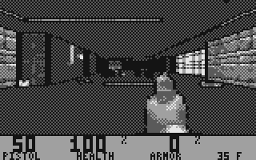
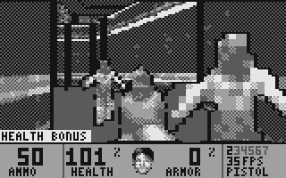
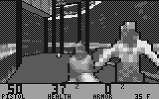
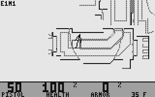
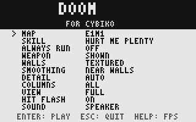
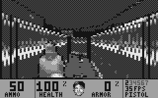

# Doom for Cybiko

> **Experimental.** Tested mostly in the Dragonfruit Cybiko emulator, on a
> PC and on the JC4827W543 ESP32-S3 board. The first try on a real Cybiko
> found no key working and the level pack not loading from the MP3 card;
> both have changes for it since (see [Doom Test](#doom-test)) that are
> not confirmed on a real Cybiko yet.

A Doom port for the Cybiko Xtreme: a native CyOS application in H8S code
that plays the original maps on the 160x100, 4-grey screen. It is meant to run
on a real Cybiko Xtreme as well as in the [Dragonfruit](https://github.com/SovGVD/Dragonfruit-JC4827W543-esp32)
Cybiko emulator. It uses no emulator hooks: the game talks to the Xtreme's
hardware (LCD controller, key matrix, timer) directly.

 

 

 

Screenshots from the PC build (see Layout) with Freedoom's E1M1, at twice
the Cybiko's size; on the device the four greys are the LCD's.

The 18 MHz H8S is far too slow for real Doom, so the picture is simplified:

- wall textures are shrunk to at most 32 texels along their longer side
  (8, 16 or none when building, see below) in 16 tones, dithered to the 4
  greys and dimmed with the sector light and the distance; floors and
  ceilings are flat dithered shades (from each flat's average brightness,
  the sector light and the distance); edges are drawn black;
- monsters, items, decorations and the weapon are their sprites shrunk to
  at most 32x32 cells in 16 tones, drawn in the 4 greys with a black
  outline;
- the view is 80 columns of 2 pixels (Doom's low detail), or 40 of 4 in
  the title menu's low detail, and 84 rows, above a 16-row status bar.

The game logic follows Doom: BSP rendering, blockmap collision, monster AI
with sight checks, all weapons, pickups, doors, lifts, stairs, crushers,
teleports, secrets and exits, and the five skill levels.

The title menu trades looks for speed before a game starts:

- WALLS: TEXTURED, TEXTURED NEAR (walls further than 512 units are flat
  shades) or FLAT;
- SMOOTHING: NEAR WALLS, the default, or OFF. A texture has at most 32
  texels along a side, so right in front of a wall a texel covers many
  pixels and the wall looks like a few flat blocks. With smoothing, where a
  texel is 4 rows or taller the tones are blended between neighbouring
  texels, so the pattern stays visible as gradients. It costs speed only
  close to walls (E1M1, facing a wall: 21 fps against 35 without);
- DETAIL: HIGH (80 columns), LOW (40 columns of 4 pixels), LOWEST (also
  one texel for two rows) or AUTO, the default: low detail only while a
  frame takes longer than 1/15 s, high again under 1/24 s, so open areas
  turn blocky and corridors stay sharp;
- VIEW: FULL (160x84), MEDIUM (a 128x68 window) or SMALL (96x52), as
  Doom's own screen size: fewer pixels to fill, with a dark frame around;
- COLUMNS: ALL, or ALTERNATE: each frame draws every other column of
  the walls and things (the odd ones, then the even ones), so a still view
  is complete and a moving one is a little rougher;
- WEAPON: SHOWN or HIDDEN (a little faster).

Speed in the emulator, E1M1, frames a second (35 is the game's tic rate):

| | start room | widest view (courtyard) | corridors |
| --- | --- | --- | --- |
| textured, high detail | 17-20 | 10-18 | 34-35 |
| textured, auto detail | 19-22 | 15-23 | 35 |
| textured near, high detail | 18-20 | 11-13 | 32-34 |
| flat, high detail | 18-23 | 12-16 | 35 |
| textured, low detail | 22-30 | 14-16 | 35 |
| textured near, low detail | 23-30 | 15-17 | 31-35 |
| flat, low detail | 23-33 | 15-21 | 35 |
| textured, auto detail, alternate columns | 20-27 | 16-21 | 35 |
| textured near, low detail, alternate columns | 26-33 | 16-22 | 35 |
| textured, high detail, medium view | 18-23 | 11-20 | 35 |
| textured, high detail, small view | 21-28 | 14-26 | 35 |
| textured, auto detail, small view | 21-28 | 16-22 | 35 |
| textured near, low detail, alternate columns, small view | 28-34 | 19-21 | 35 |

A smaller view gains less than its pixel count, since much of a frame is
the game, the walls' and things' setup and the copy to the LCD (only the
window's rows when nothing else changed). LOWEST is no faster than LOW: with 40 columns the time goes to the
per-column setup, the BSP walk, the sprites and the copy to the LCD rather
than to filling the columns.

The texture size changes only the pack's size, not the speed.

## Building

Needs Python 3 (with nothing extra) and the GNU H8 tools (Debian/Ubuntu:
`binutils-h8300-hms gcc-h8300-hms`).

    ./build.sh doom1.wad                    # all the WAD's maps
    ./build.sh doom1.wad E1M1,E1M2          # pick the maps
    TEXELS=16 ./build.sh doom1.wad          # coarser wall textures, smaller pack
    TEXELS=0 ./build.sh doom1.wad E1M1      # no textures: the smallest pack

This makes:

- `build/doom.app`, the game (about 59 KB). Put it on the Cybiko with the
  Cybiko console software, or into `/Cybiko/apps` on the Dragonfruit SD
  card. It shows up in Games (`APPTYPE=root ./build.sh ...` puts it on the
  main desktop instead).
- `build/doomtest.app`, the Doom Test app (see [Doom Test](#doom-test)),
  for checking a real Cybiko.
- `build/pack/`, the level pack: `doom.dat` (about 19 KB: the map list and
  the shrunk sprites) and a file per map, `doom_e1m1.dat` and so on
  (22-61 KB each in the shareware episode: the map with its shrunk wall
  textures). All of it is packed with Deflate. The game looks for each
  file on the MP3 cartridge's card first (`/MP3/`, the card's top folder;
  on Dragonfruit that is `/Cybiko/card/` on the SD card) and then in the
  Cybiko's own storage (next to the app), and offers the maps whose files
  it finds: copy over only the maps you want.

The shareware episode's 9 maps make 382 KB in all (343 KB with
`TEXELS=16`, 331 KB with `TEXELS=8`, 323 KB with `TEXELS=0`). The app,
`doom.dat` and E1M1 take about 105 KB of the Cybiko's own storage.

The game unpacks the sprites when it starts and each map when it is played
(about 3 seconds for E1M1 in the emulator, while CyOS shows its busy
sign). It needs about 350 KB of RAM, plus the sprites (about 40 KB) and
room for the biggest map it found unpacked (up to 146 KB in the shareware
episode).

## The WAD and its licence

No game data is in this repository. `build.sh` converts maps and shrunk
sprites from a Doom IWAD you supply into the app:

- `doom1.wad`, the shareware Doom 1.9 episode. Its licence allows passing on
  only the unmodified shareware package, so do not share a `doom.app` built
  from it.
- `doom.wad` / `doom2.wad`, the commercial games: for your own use only.
- `freedoom1.wad` / `freedoom2.wad` from [Freedoom](https://freedoom.github.io/),
  BSD-licensed: an app built from it can be shared.

## Keys

| Key | Action |
| --- | --- |
| Up/Down or W/S | walk |
| Left/Right | turn |
| Fn + Left/Right, A/D or `,` `.` | strafe |
| Shift | run (Select: always run) |
| Space or K | fire |
| Enter or E | open doors, press switches |
| F1-F7, Tab | weapons, next weapon |
| Menu or M | map |
| Help | frames per second on/off |
| Esc | pause; Esc again quits |

## Doom Test

`build/doomtest.app` ("Doom Test") checks on a real Cybiko what the game
needs from it. Put it on the Cybiko next to Doom and run it:

1. **Files.** It shows the biggest block of free memory, what Doom finds
   of its level pack and why not (`DOOM.DAT NOT FOUND`, `NO MEMORY FOR
   THE MAPS` ...), the memory the pack asks for (`NEEDS` the sprites +
   the biggest map, in KB), whether each map reads and unpacks (`OK`,
   `READ`, `UNPK`), and the last file reads: the path, then the bytes read
   of the bytes asked for (`@` the offset), or `NOT OPENED`. Any key, or
   30 seconds, goes on.
2. **Keys.** The key matrix, live, read three ways: one CPU read per row
   (`CPU`, how Doom read the keys at first), twelve CPU reads in a row
   (`X12`), and the DMA reads CyOS itself uses (`DMA`, how Doom reads
   them now). Each row shows the keys down as a hex mask, `ALL` all rows
   at once; `DOOM KEYS` names the game keys seen, and `SEEN` says which way
   has seen any key so far. Hold Esc for a second to quit (it also quits
   after 60 seconds without a key).

A photo of each page, with a few keys held on the second, tells what goes
wrong. The game's own "no pack" screen also shows the reason, the memory
needed and the last file reads.

## Layout

- `src/` the game: renderer (`render.c`), map loading (`level.c`), things
  and physics (`mobj.c`), monsters (`ai.c`), the player (`player.c`), doors,
  lifts and other specials (`spec.c`), menus and the main loop (`main.c`).
- `cybiko/` the Cybiko side: hardware access and file reading
  (`hw_cybiko.c`), runtime and division helpers (`rt.s`), the CyOS
  functions it calls (`cyos.ld`), the link script, icon and help page;
  `doomtest.c`, the Doom Test app.
- `tools/wad2cy.py` converts a WAD into the level pack; `src/inflate.c`
  unpacks it;
  `tools/cybiko_mkapp.py` and `tools/cybiko_cap.py` make the CyOS `.app`.
- `pc/` a PC build of the game code for testing: it writes frames as PGM
  images (`make -C pc`, then `pc/doom_pc build/pack/doom.dat --frames N --shots DIR`).

## Notes on the Cybiko

General facts about native CyOS applications (imports, the loader, on-chip
RAM, the watchdog, the decompressor's window, the MP3 card) are in
cybiko-docs'
[cyos.md](https://github.com/SovGVD/cybiko-docs/blob/main/cyos.md#native-applications).
How the game uses them:

- The game turns interrupts off while it runs and so has the whole CPU;
  it resets the watchdog itself and gives CyOS its interrupts back on exit.
- The keys are read the way CyOS 1.5.08 reads them (found by tracing its
  keyboard reads in the emulator): DMA channel 1 in full address mode
  reads the row's address 12 times in one burst into a word of on-chip
  RAM, with the refresh timer stopped, and the last read counts. The
  matrix rows are selected by address lines, so the address has to stay
  on the bus for a while; a lone CPU read between instruction fetches
  from DRAM likely reads before the lines settle, which would explain no
  key working on the first real Cybiko. Emulators answer at once either
  way. A read with all rows selected comes first, so a frame with no key
  down costs one burst.
- The on-chip RAM, three times faster than DRAM, holds the renderer's hot
  code (the column, texture and sprite routines from `render.c`, `hw_init` copies the `.iramfn` section there; the fill
  loops and the division and multiplication helpers from `rt.s`), its hot
  tables (among them the texture dither bytes for all 32 lights, 1 KB) and
  the stack (`cybiko/link.ld`). CyOS's contents are kept aside and put back
  on exit, and the DTC is off meanwhile. The screen buffer stayed in DRAM:
  the code gains more there than the fills lose.
- That leaves the stack about 1.1 KB, so nothing in the game recurses:
  the BSP walks of the renderer and of the sight checks keep their pending
  nodes on small arrays, and the sound that wakes monsters floods the
  sectors breadth first (`render_bsp`, `cross_bsp`, `sound_flood`). The
  game needs about 450 bytes of stack; a deeper call chain shows up as
  garbage in the renderer's tables, then a freeze.
- In high detail two columns share a byte of the screen buffer, so the odd
  columns are drawn into a second buffer (`fb2`) and the two are or'ed on
  the way to the LCD: no fill reads a byte before writing it. Whatever
  else draws over the view tells the renderer (`render_drawn_over`).
- The textured column loop (`tline` in `rt.s`) avoids address arithmetic:
  a texture column is aligned to its own size in the map (`wad2cy.py`
  pads them, `level.c` aligns the map buffer to 64 bytes) and the dither
  tables to 32 bytes, so a texel or a dither byte is reached by setting
  the low bits of an address.
- The pack is read with CyOS's own file functions (`FileInput`,
  `Input_read`; `cybiko/cyos.ld` has their export numbers):
  `cybiko_mkapp.py` turns calls to `0xf00000 + N` into imports of kernel
  export N. To read a map while the game runs, the game hands the machine
  back to CyOS for that time (its on-chip RAM, the DTC and the interrupts,
  on CyOS's stack), so CyOS's own screen can show for a moment while a map
  loads.
- The MP3 cartridge's card is CyOS's `/MP3/` only with the cartridge
  software installed (the "MP3Soft" pack; see cybiko-docs). Files are read
  in pieces of at most 4 KB, like the MP3 Player's reads, in case a real
  card or its driver has trouble with long runs of blocks. With the
  cartridge software running there is less free memory: in the emulator
  about 240 KB with the stock RAM disk, against the 183 KB the shareware
  pack asks for (39 KB of sprites, 144 KB for the biggest map). Bigger
  maps, such as Freedoom's, do not fit then; the "no pack" screen says so.
- The game's tables are stored as zeros in the module (CyOS loads only a
  small zeroed data area; the `.app` compression removes the zeros).
- `cybiko_cap.py` makes no back reference further than 8191 bytes (the CyOS
  decompressor's window).

## Credits

- Doom is id Software's; this port follows its game rules and map format.
  The screenshots use [Freedoom](https://freedoom.github.io/)'s maps.
- What is known about the Cybiko hardware started with Tim Schuerewegen's
  Cybiko driver in [MAME](https://www.mamedev.org/), then grew in
  [cybiko-docs](https://github.com/SovGVD/cybiko-docs); the key reading
  copies CyOS's own.

## Licence

MIT for the code here. Doom is a trademark of id Software; this is an
unofficial fan port; its code was written for the Cybiko and it contains no id Software data.
